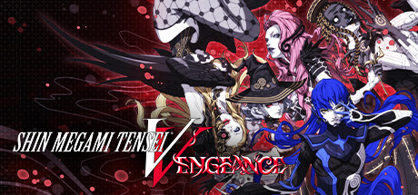

**Shin Megami Tensei V is the mainline SMT entry following a high school student who merges with a supernatural being called Aogami in a post-apocalyptic Tokyo. Features the challenging Press Turn combat system, hundreds of demon negotiations, and brutal difficulty.**

---

## 📖 About

Shin Megami Tensei V is the mainline SMT entry following a high school student who merges with a supernatural being called Aogami in a post-apocalyptic Tokyo. Features the challenging Press Turn combat system, hundreds of demon negotiations, and brutal difficulty.

## ⚠️ Problems Without Trainer

| Problem | Status |
|---------|--------|
| **Press Turn Punishing** — Enemies exploiting weaknesses can wipe your party in a single round | ✅ Solved |
| **Demon Negotiation RNG** — Recruiting some demons requires perfect dialogue choices with RNG | ✅ Solved |
| **Essence Fusion Depth** — Optimizing skill inheritance for end-game requires deep system knowledge | ✅ Solved |
| **Resource Scarcity** — Incense for stat boosts and Macca for fusing are always in short supply | ✅ Solved |

## ✅ Solution

The **Shin Megami Tensei V Trainer** solves all these issues by giving you complete control over the game.

## 🎯 Full Feature List

- Unlimited Resources
- God Mode / Invincibility
- Instant Skill Cooldown
- One-Hit Kill
- Freeze Game Timer
- Unlock All Items & Achievements
- Custom Speed Multiplier
- Save State Anywhere

## 🚀 Quick Start

1. **Disable Windows Defender** temporarily (trainer may trigger false positive)
2. Download the trainer from the button above
3. Launch Shin Megami Tensei V
4. Run the trainer as Administrator
5. Activate desired cheats with hotkeys

## 💎 Free vs Paid

| Feature | Free | Pro |
|---------|------|-----|
| Basic God Mode | ✅ | ✅ |
| Unlimited Resources | ✅ | ✅ |
| All Advanced Cheats | ❌ | ✅ |
| Auto-Updates | ❌ | ✅ |
| Priority Support | ❌ | ✅ |

## 💻 Requirements

- Windows 10/11 (64-bit)
- Shin Megami Tensei V (any version)
- .NET Framework 4.8+
- DirectX 11+

## 🍎 macOS

macOS users can use our alternative tool:

## ⚖️ Legal

This trainer is for educational and single-player use only. Use responsibly.

---

